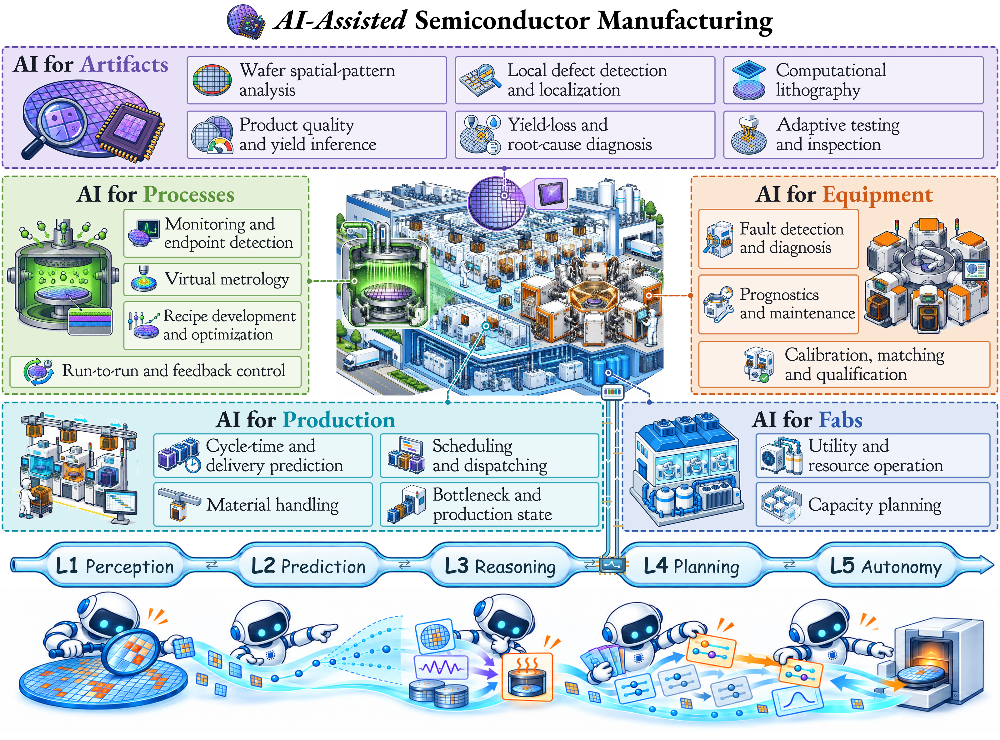
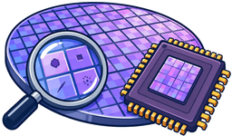
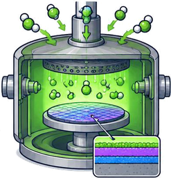
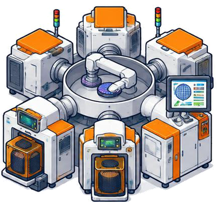
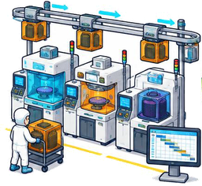
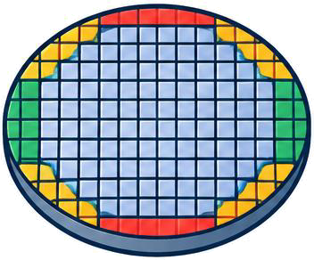
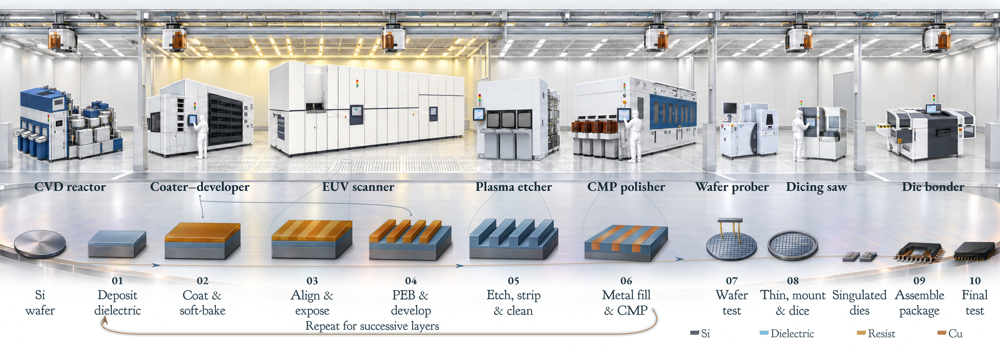

<h1 align="center">Awesome AI-Assisted Semiconductor Manufacturing</h1>
<p align="center">A growing collection of research on AI-assisted semiconductor manufacturing.</p>
<p align="center"><b>From Perception to Autonomy: A Survey on AI-Assisted Semiconductor Manufacturing</b></p>

<p align="center">
  <a href="https://awesome.re"></a>
  <a href="#citation"></a>
  <a href="CONTRIBUTING.md"></a>
</p>

<p align="center">⭐ Find this collection useful? Give it a star to help others discover it.</p>

<p align="center"><span><a href="mailto:rzhong@zju.edu.cn">Rui Zhong</a><sup>1</sup></span> · <span><a href="mailto:3230106225@zju.edu.cn">Zhikun Huang</a><sup>1</sup></span> · <span><a href="mailto:xuezhangxz@zju.edu.cn">Xue Zhang</a><sup>1</sup></span> · <span><a href="mailto:jinqian2022@zju.edu.cn">Qian Jin</a><sup>1</sup></span> · <span><a href="mailto:li.yu@zju.edu.cn">Yu Li</a><sup>1</sup></span><br>
<span><a href="mailto:qisunchn@zju.edu.cn">Qi Sun</a><sup>1</sup></span> · <span><a href="mailto:dawei_gao@zju.edu.cn">Dawei Gao</a><sup>2,1</sup></span> · <span><a href="mailto:yi.song@zju.edu.cn">Yi Song</a><sup>1</sup></span> · <span><a href="mailto:hanmingwu@zju.edu.cn">Hanming Wu</a><sup>1,*</sup></span> · <span><a href="mailto:czhuo@zju.edu.cn">Cheng Zhuo</a><sup>1,*</sup></span></p>
<p align="center"><sub><span><sup>1</sup> College of Integrated Circuits, Zhejiang University</span> &nbsp; <span><sup>2</sup> Zhejiang ICsprout Semiconductor Co., Ltd.</span><br>* Corresponding authors.</sub></p>

<p align="center">
  <a href="https://zrrraa.github.io/Awesome-AI-Assisted-Semiconductor-Manufacturing/"></a>
</p>

<p align="center"></p>

<p align="center">
  <a href="#papers"><b>Browse by task</b></a> &nbsp; · &nbsp;
  <a href="docs/getting-started.md">Reading guide</a> &nbsp; · &nbsp;
  <a href="RESOURCES.md">Datasets &amp; code</a>
</p>

## 💡 About

How can AI move from recognizing a defect to coordinating a factory? Semiconductor manufacturing connects processes, equipment and production decisions, so progress in one task matters through its effects on the others. Our survey and growing paper collection trace this path **from Perception to Autonomy**, helping readers understand where AI is useful, what each task requires and how decisions shape manufacturing outcomes.

<a id="news"></a>

## 🔥 News

- **2026-10-10** — Our project page is live! Explore the collection by manufacturing task and AI stage.
- **2026-10-08** — We released the paper collection for our survey.

<a id="citation"></a>

## 📝 Citation

If you find this collection or our survey useful, please cite:

```bibtex
@unpublished{zhong2026perception,
  title = {From Perception to Autonomy: A Survey on {AI}-Assisted Semiconductor Manufacturing},
  author = {Zhong, Rui and Huang, Zhikun and Zhang, Xue and Jin, Qian and Li, Yu and Sun, Qi and Gao, Dawei and Song, Yi and Wu, Hanming and Zhuo, Cheng},
  year = {2026},
  note = {Manuscript}
}
```

## ✳ From Perception to Autonomy

Five AI stages describe AI’s growing role in manufacturing: recognizing patterns, estimating outcomes, comparing explanations, choosing actions, and executing and adjusting them through feedback. A paper can address several stages.

<p align="center"></p>

[◉ **Perception**](https://zrrraa.github.io/Awesome-AI-Assisted-Semiconductor-Manufacturing/explore.html?stage=L1) · [◇ **Prediction**](https://zrrraa.github.io/Awesome-AI-Assisted-Semiconductor-Manufacturing/explore.html?stage=L2) · [✳ **Reasoning**](https://zrrraa.github.io/Awesome-AI-Assisted-Semiconductor-Manufacturing/explore.html?stage=L3) · [⤴ **Planning**](https://zrrraa.github.io/Awesome-AI-Assisted-Semiconductor-Manufacturing/explore.html?stage=L4) · [↻ **Autonomy**](https://zrrraa.github.io/Awesome-AI-Assisted-Semiconductor-Manufacturing/explore.html?stage=L5)

[Explore scope × stage and research over time →](https://zrrraa.github.io/Awesome-AI-Assisted-Semiconductor-Manufacturing/#coverage)

<a id="papers"></a>
<a id="browse-by-manufacturing-task"></a>

## 🧭 Explore by manufacturing task

Choose a manufacturing question and follow its research. Each entry includes the venue, authors, paper and resource links, and its manufacturing scope, task and AI stages. Conference and journal papers link to related publications. A separate **Trends: Counted with …** badge identifies entries grouped into one study for statistics.

<table>
<tr>
<td valign="top" width="33%"><h3><a href="papers/artifacts.md">M1 · Artifacts</a></h3><p><sub>Products, patterns &amp; quality</sub></p><p><a href="papers/artifacts.md#a1"><b>A1</b> · Wafer spatial-pattern analysis</a><br><br><a href="papers/artifacts.md#a2"><b>A2</b> · Local defect detection and localization</a><br><br><a href="papers/artifacts.md#a3"><b>A3</b> · Computational lithography</a><br><br><a href="papers/artifacts.md#a4"><b>A4</b> · Product quality and yield inference</a><br><br><a href="papers/artifacts.md#a5"><b>A5</b> · Yield-loss diagnosis and root-cause analysis</a><br><br><a href="papers/artifacts.md#a6"><b>A6</b> · Adaptive testing and inspection</a></p></td>
<td valign="top" width="33%"><h3><a href="papers/processes.md">M2 · Processes</a></h3><p><sub>Measurements, recipes &amp; control</sub></p><p><a href="papers/processes.md#p1"><b>P1</b> · Process monitoring and endpoint detection</a><br><br><a href="papers/processes.md#p2"><b>P2</b> · Virtual metrology</a><br><br><a href="papers/processes.md#p3"><b>P3</b> · Process development and recipe optimization</a><br><br><a href="papers/processes.md#p4"><b>P4</b> · Run-to-run and feedback control</a></p></td>
<td valign="top" width="33%"><h3><a href="papers/equipment.md">M3 · Equipment</a></h3><p><sub>Health, maintenance &amp; readiness</sub></p><p><a href="papers/equipment.md#e1"><b>E1</b> · Fault detection and diagnosis</a><br><br><a href="papers/equipment.md#e2"><b>E2</b> · Prognostics and maintenance</a><br><br><a href="papers/equipment.md#e3"><b>E3</b> · Calibration, matching and qualification</a></p></td>
</tr><tr>
<td valign="top" width="33%"><h3><a href="papers/production.md">M4 · Production</a></h3><p><sub>Lots, schedules &amp; material flow</sub></p><p><a href="papers/production.md#r1"><b>R1</b> · Cycle-time and delivery prediction</a><br><br><a href="papers/production.md#r2"><b>R2</b> · Scheduling and dispatching</a><br><br><a href="papers/production.md#r3"><b>R3</b> · Material handling</a><br><br><a href="papers/production.md#r4"><b>R4</b> · Bottleneck and production-state analysis</a></p></td>
<td valign="top" width="33%"><h3><a href="papers/fabs.md">M5 · Fabs</a></h3><p><sub>Utilities, resources &amp; capacity</sub></p><p><a href="papers/fabs.md#f1"><b>F1</b> · Utility and resource operation</a><br><br><a href="papers/fabs.md#f2"><b>F2</b> · Capacity planning</a></p></td>
<td valign="top"><h3>Choose a reading path</h3><p>New to the field?<br>Start with the <a href="docs/getting-started.md">reading guide</a>.</p><p>Search by title, author or venue, and filter by year in the <a href="https://zrrraa.github.io/Awesome-AI-Assisted-Semiconductor-Manufacturing/explore.html">interactive paper library ↗</a>.</p></td></tr>
</table>

[📖 Full bibliography](references.bib) · [🧰 Datasets & code](RESOURCES.md)

## 💡 From manufacturing data to manufacturing decisions

From wafer fabrication to testing and packaging, each operation changes what comes next. Understanding these connections helps explain why better results in one task do not always improve the factory as a whole.

<p align="center"></p>

<table>
<tr>
<td width="33%" valign="top"><b>🔎 Use information and experience</b><br>Preserving relevant detail and reusing physical knowledge help models choose useful actions.</td>
<td width="33%" valign="top"><b>🎯 Follow the effects of a decision</b><br>A change to one task can affect later operations and other tasks sharing equipment and resources.</td>
<td width="33%" valign="top"><b>🔄 Learn from manufacturing outcomes</b><br>Feedback guides subsequent decisions and improves the models and procedures behind them.</td>
</tr>
</table>

The central question is how task-level progress improves quality, delivery and resource use across a connected factory. Scarce useful data, changing conditions, fragmented observations and costly experiments remain common obstacles. Together, these findings motivate an **AI-native autonomous virtual fab**:

- **Operating loop — compare actions and coordinate execution.** World models predict the consequences of recipe, equipment and scheduling changes. Agents coordinate plans across tasks; controllers and transport systems execute the actions. New measurements inform the next decision. Physical AI extends the loop to adaptive robotic inspection and maintenance.
- **Learning loop — improve models and decision procedures.** Operating feedback improves world models and agent workflows. Recurring errors guide changes to experiments, models and diagnostic steps. Accumulated experience helps tackle new development problems with fewer physical trials.

**Recursive self-improvement (RSI)** extends the learning loop to the procedure that proposes and evaluates improvements.

[🤝 Contribute a paper](CONTRIBUTING.md)

🚀 We’re building [**Fab-XR**](https://fabxr.cn/), an AI-native XR fab.
